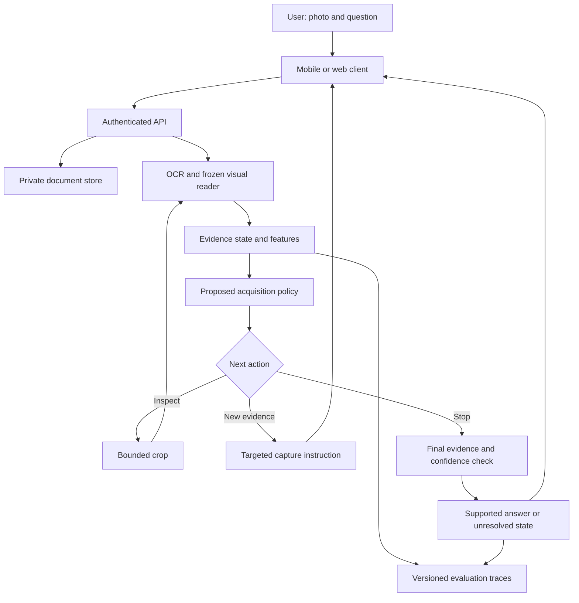

# BSCS FYP research decision report

**Review date:** 7 October 2026. **Team:** three BSCS students. **Horizon:** approximately 10–12 months. **Compute:** undergraduate budget; pretrained models and small learned components.

## PART A — Executive summary

**Recommendation: Task-Conditioned Evidence Reacquisition for Reliable Mobile Document Understanding.** Build a web/mobile document-reading platform whose research component learns when to answer, inspect a crop, request one specific new photograph, or abstain. Begin with receipts, bills and simple notices; extract exact fields and show their evidence. No payments, medical decisions or autonomous form submission.

The research question is: **Can a policy trained to predict the benefit of a particular evidence-acquisition action recover more correct, visually supported answers than strong fixed rules, under the same model, tool, API and user-interruption budgets?**

The proposed contribution is an action-benefit predictor and its evaluation on real capture sequences. It is not OCR, document chat, image-quality detection, cropping, calibration, or asking for another picture: all have prior art.

The literature supports the problem but also sharply limits the novelty claim. WildDoc tests real capture degradation [R1]; DocHallu studies fabricated readings of damaged document content [R2]; VRD-UQA tests unanswerable document questions [R3]. BCEA already combines evidence acquisition and calibrated abstention [R4]. Q-Guide already directs document perception using the question [R5]. DocIntent already performs answerability-guided restoration [R6]. Commercial scanners already assess image quality, and Adobe already offers scanned-document question answering [R7–R9].

**Novelty confidence: medium for the narrow contribution; low for the broad application.** The specific comparison between learned task-conditioned physical reacquisition, generic retakes and additional model computation appears worth investigating. This is a defensible research hypothesis, not a verified first-ever invention.

Why this wins: meaningful multimodality; public starting datasets; a small trainable policy; exact-value outcomes; a natural mobile camera workflow; a useful engineering fallback; and a general research direction in decision-making with incomplete observations. The major uncertainty is whether a learned policy beats a simple rule once it receives the same action options and budget.

### Review method and limits

The review used public web discovery and primary papers, proceedings, author repositories, dataset cards and official product documentation. Discovery included Google Scholar and Semantic Scholar results, arXiv, ACL/AAAI/CVF/PMLR proceedings, IEEE Xplore, ACM, Springer, ScienceDirect, Nature, GitHub and relevant document-capture patents. Some index searches returned little useful material and some publisher pages did not expose full text. Those were not treated as full-text reviews. Close competitors were followed to primary records where available. This is a focused scoping and novelty review, not an exhaustive systematic review or patent freedom-to-operate opinion. It does not prove that no equivalent unpublished or proprietary implementation exists. The broad pool is screened less deeply than the five finalists, and the winner receives the strongest collision check.

Publication status is identified conservatively: BCEA, Q-Guide and DocIntent are treated here as preprints. A repository's acceptance statement is not a substitute for checking final proceedings before citing a venue in a submission. All improvements below are proposed success criteria, not experimental results.

## PART B — 26 candidate directions

Scores are expert decision judgments on a 1–10 scale, not measured probabilities. Novelty assesses the scoped research mechanism, impact its potential beneficiaries, feasibility one-year delivery, AI depth the nontrivial modeling involved, research depth the experimental questions, product potential repeat utility, and PhD potential longer-term unresolved problems. Risk is reversed: **1 = low risk, 10 = high risk**. A high average cannot override inaccessible data or unsafe scope.

Novelty classes: **NC** = novel combination of established techniques; **UA** = underexplored application/constraint; **I** = incremental; **HR** = heavily researched; **CS** = commercially saturated. No candidate earns an unqualified “highly novel” label.

| # | Idea and research problem | Novelty | Impact | Feasibility | AI depth | Research depth | Product | PhD | Risk |
|---|---|---:|---:|---:|---:|---:|---:|---:|---:|
| 1 | Task-conditioned document reacquisition: choose the next observation by expected answer benefit | NC/7 | 9 | 8 | 8 | 9 | 8 | 9 | 5 |
| 2 | Availability-aware VLM routing: preserve quality under outages, privacy restrictions and degraded inputs | I/6 | 9 | 7 | 9 | 9 | 8 | 9 | 6 |
| 3 | Cost-sensitive spoken clarification: repair consequential Urdu-English task fields with few interruptions | NC/6 | 9 | 8 | 8 | 8 | 9 | 8 | 5 |
| 4 | Verification-grounded misconception diagnosis: select a diagnostic probe that distinguishes competing explanations | NC/6 | 8 | 8 | 8 | 8 | 8 | 8 | 5 |
| 5 | Selective multimodal phishing detection: withhold unsupported reassurance when evidence disappears or shifts | I/5 | 9 | 7 | 8 | 8 | 9 | 8 | 7 |
| 6 | Temporal personal memory: reconcile changing facts and contradictory sources | HR/4 | 9 | 8 | 8 | 9 | 9 | 9 | 6 |
| 7 | Multimodal memory revocation: remove information from text, images and derived state | HR/4 | 9 | 6 | 9 | 9 | 8 | 10 | 8 |
| 8 | Evidence-sufficiency RAG: identify when retrieved context cannot support an answer | HR/4 | 8 | 9 | 7 | 8 | 8 | 8 | 4 |
| 9 | Scientific evidence synthesis: verify cross-paper claims and contradictions | HR/5 | 8 | 6 | 8 | 9 | 8 | 9 | 7 |
| 10 | Mobile GUI recovery: verify actions and recover from unexpected interface states | HR/5 | 9 | 6 | 9 | 9 | 9 | 9 | 8 |
| 11 | Active visual assistance: guide camera use when an image is insufficient | UA/6 | 9 | 6 | 8 | 9 | 9 | 9 | 8 |
| 12 | Federated keyboard adaptation: personalize without leaking rare user phrases | HR/5 | 8 | 5 | 9 | 9 | 8 | 9 | 8 |
| 13 | Continual preference learning: separate genuine change from noisy feedback | HR/5 | 8 | 6 | 8 | 9 | 8 | 9 | 7 |
| 14 | Open-set crop disease recognition: recognize unfamiliar field conditions and abstain | I/5 | 9 | 7 | 8 | 8 | 8 | 8 | 7 |
| 15 | Flood evidence fusion: handle missing or contradictory satellite/citizen observations | UA/6 | 9 | 5 | 9 | 9 | 7 | 9 | 8 |
| 16 | Road-damage adaptation: transfer across cameras, countries and road surfaces | I/5 | 8 | 7 | 8 | 8 | 7 | 8 | 6 |
| 17 | Multilingual visual misinformation: detect missing context across languages | HR/5 | 9 | 6 | 8 | 9 | 8 | 9 | 8 |
| 18 | Unseen-generator deepfake detection: maintain calibration outside training generators | HR/5 | 9 | 5 | 9 | 9 | 8 | 9 | 9 |
| 19 | Accent-robust ASR: target important errors rather than average word error | I/5 | 9 | 8 | 8 | 8 | 9 | 8 | 5 |
| 20 | Multimodal clinical triage: recognize uncertainty under incomplete histories | HR/4 | 10 | 3 | 9 | 10 | 9 | 10 | 10 |
| 21 | Medical report verification: detect unsupported image-derived statements | HR/5 | 9 | 4 | 9 | 9 | 8 | 9 | 9 |
| 22 | Household energy forecasting: adapt a small foundation model under sparse history | I/4 | 7 | 8 | 7 | 7 | 7 | 7 | 5 |
| 23 | Screenshot-to-bug reproduction: produce an executable failing test from visual issue evidence | HR/5 | 8 | 6 | 9 | 9 | 8 | 9 | 8 |
| 24 | Prompt-injection containment: preserve task utility while restricting untrusted instructions | HR/4 | 9 | 7 | 9 | 9 | 8 | 9 | 8 |
| 25 | Digital identity forgery detection: generalize to unseen document and attack types | HR/4 | 9 | 4 | 9 | 9 | 8 | 9 | 9 |
| 26 | Simulation-based VLA robustness: recover from language and visual distribution shifts | HR/5 | 8 | 4 | 10 | 10 | 6 | 10 | 9 |

Evidence anchors include [R1–R6] for documents; [R10–R13] for routing; [R14–R18] for speech; [R19–R22] for tutoring; [R23–R25] for phishing; [R26–R30] for memory; and [R31–R41] for the remaining screened domains. Scores reflect the constraints of this team, not the overall scientific value of those fields.

## PART C — Elimination

Five directions survive. “Rejected” means unsuitable as this team's primary proposal, not academically unimportant. For the rejected pool, the table records a possible intervention and evaluation route so that rejection does not rest on vague impressions. Dataset names indicate a starting route, not a promise of unrestricted access or sufficient labels.

| # | Baseline → possible intervention | Data and primary measurement | Decision and limiting resource |
|---|---|---|---|
| 6 | Vector/recency memory → conflict-aware update | LongMemEval, MemoryAgentBench; update accuracy at equal tokens | Reject broad novelty: temporal memory is already well developed; API costs grow with histories [R26–R28]. |
| 7 | Delete records → provenance-guided revocation | MemLeak; leakage and retained utility | Reject proposed broad claim: direct 2026 competitors include image leakage and execution-state unlearning [R29–R30]. |
| 8 | Standard RAG → sufficient-evidence gate | Sufficient Context benchmarks; supported accuracy/coverage | Use as a baseline component, not the FYP contribution [R31]. Laptop/API feasible but crowded. |
| 9 | Retrieve-and-summarize → claim-level evidence checking | ScholarQABench; citation support and completeness | Reject: expert scientific annotation and realistic literature synthesis are expensive [R32]. |
| 10 | Reactive GUI agent → state verification/recovery | AndroidWorld and D-GARA; completion/recovery rate | Reject primary scope: existing state-aware recovery and expensive flaky device execution [R33]. |
| 11 | Direct visual QA → targeted camera instruction | VisAssist, VizWiz; answerability/task success | Reserve for later: representative user recruitment and accessibility validation are essential [R34]. |
| 12 | FedAvg → privacy-aware personalization | Simulated clients; utility vs communication and membership inference | Reject: public simulation does not establish real keyboard privacy or adoption; no verified local partner corpus. |
| 13 | Static preference model → drift-aware updates | Longitudinal preference histories; adaptation regret/retention | Reject without a longitudinal dataset and stable preference ground truth. |
| 14 | Closed-set classifier → calibrated unknown detection | PlantSeg/PlantDoc; open-set F1, calibration, field transfer | Reserve: modest-GPU feasible, but local diagnosis labels need agricultural expertise [R35]. |
| 15 | U-Net → missing-modality fusion | Sen1Floods11/FloodCastBench; IoU and cross-event calibration | Reject product claims: satellite data are not aligned citizen reports; field response validation needs partners [R36]. |
| 16 | Single-country detector → adaptation | RDD2022; country-held-out mAP | Feasible reserve; novelty narrower and local maintenance workflow needs stakeholders [R37]. |
| 17 | Text-only checking → cross-modal/context evidence | M4FC; macro-F1 and evidence precision | Reject primary scope: fact truth, time and source provenance are costly to annotate; broad task too open [R38]. |
| 18 | Fixed detector → unseen-generator adaptation | Cross-generator deepfake suites; AUROC at fixed FPR | Reject: fast adversarial drift and compute/data demands; no claim of universal detection [R39]. |
| 19 | Whisper → small adaptation | Urdu ASR data; WER and critical-slot accuracy | Fold into finalist 3; standalone fine-tuning has weak novelty [R16]. |
| 20 | General LLM → selective triage | AgentClinic; simulated task accuracy | Reject: simulation does not validate clinical safety, and no clinical partner is specified [R40]. |
| 21 | VLM report → grounded verification | Access-controlled clinical imaging corpora; supported findings | Reject without clinical annotation, approved data access and domain supervision. |
| 22 | Seasonal/linear baseline → sparse-history adaptation | Public energy/time-series sets; MASE and interval coverage | Feasible reserve; strong forecasting tools exist and multimodal mobile role is weak [R41]. |
| 23 | Coding agent → screenshot-grounded reproducer | SWE-bench Multimodal; valid reproductions, resolution and cost | Reject primary scope: sandbox/harness effort and compute compete with web/mobile delivery [R42]. |
| 24 | Prompt-only guard → information-flow control | AgentDojo/CaMeL; attack success vs task utility | Reject generic security novelty; strong structural defenses already exist [R43]. |
| 25 | Forgery classifier → shift-aware abstention | A suitable licensed local identity corpus is not verified | Reject: sensitive data, real attack coverage and operational validation unavailable. |
| 26 | VLA policy → robustness controller | LIBERO variants; task success under perturbations | Reject: simulation/tooling and GPU burden; weak immediate mobile-product fit [R44]. |

This screen also rejects basic chatbots, generic recommendation systems, standard disease predictors, ordinary document chat, face recognition and CRUD products as standalone research contributions. They do not become research by adding multiple frameworks.

## PART D — Top five, fully scoped

### 1. Task-Conditioned Evidence Reacquisition for Reliable Mobile Document Understanding

1. **Title:** As above; use a descriptive research title rather than claiming a novel foundation model.
2. **Concept:** A reader that asks for the most useful next photograph when the current evidence is insufficient.
3. **Problem:** A bill's title can be clear while its due date is obscured. A generic image-quality score cannot alone determine whether a particular question is answerable.
4. **Gap:** Determine whether predicting the benefit of different physical capture actions improves supported task completion under limited interactions. Existing documented work supplies very close pieces, so this is a narrow, provisional gap [R1–R9].
5. **Innovation:** A small action-benefit model conditioned on question, visible field region, degradation signals and observed reader disagreement; a cost-sensitive controller chooses an action from a fixed menu.
6. **Novelty class:** NC with an incremental algorithmic contribution. Physical reacquisition is distinguished from reprocessing the same pixels, but is not itself new.
7. **Related work:** BCEA is a calibration/acquisition baseline; Q-Guide is a question-guided perception baseline; DocIntent is a task-aware restoration baseline. None should be represented as a primitive one-pass system. Scanbot/ABBYY/Adobe are product competitors [R4–R9].
8. **Architecture:** User → mobile camera/web upload → API/object store → OCR and frozen VLM → evidence features → learned action policy → crop/new capture/abstain → exact answer and evidence overlay.
9. **AI purpose:** OCR gives text and boxes; the VLM handles layout/question meaning; the learned policy predicts acquisition benefit; calibrated confidence gates outputs. No RAG, knowledge graph, multi-agent network or weight-level continual learning is required.
10. **Data:** Public DocVQA-derived development data; untouched WildDoc/DocHallu/VRD-UQA external tests where source overlap permits; approximately 300 locally consented or purpose-created document instances with recorded capture actions. Public paired views are not automatically labeled responses to instructions.
11. **Baselines:** Direct reader; crop-only; OCR-quality retake; generic retake; strong deterministic task-aware controller; prompt-based action selection; adapted recent research baselines. Give methods equal action menus and budgets.
12. **Experiments:** Answerability, correct supported completion, equal-budget policy comparison, unseen templates/devices/language, and a small randomized user study.
13. **Metrics:** Exact critical-field accuracy, supported completion per submitted task, wrong/unsupported answer rate among answered tasks, risk–coverage curve, retakes, completion time, API cost and user abandonment. ANLS is supplementary, not the main metric for amounts/dates.
14. **Meaningful outcome:** Pre-register roughly +10 percentage points supported completion at the same budgets, or ≥20% less acquisition burden at matched quality, after a pilot. These are targets, not forecasts. The primary claim requires uncertainty intervals and a specified error constraint.
15. **Phases:** Months 1–3 baseline/data/MVP; 4–6 policy and capture dataset; 7–8 integration/external tests; 9–10 evaluation and thesis; 11–12 buffer if available.
16. **Team:** Student A models/policy; B API/database/web; C mobile/data/evaluation. All audit labels and reproduce experiments.
17. **Stack:** React/TypeScript; React Native; FastAPI; PostgreSQL; object storage; OCR; PyTorch/Transformers; small gradient-boosted or MLP policy; Docker; OpenTelemetry/MLflow; pytest/Playwright. No vector database initially.
18. **Cost:** Planning range approximately USD 650–1,600 for the team over the project, excluding existing hardware, labor, travel and optional store fees. See the detailed budget below.
19. **Compute:** Laptop for application/OCR/policy work; a 16–24 GB cloud GPU or a selected API for VLM experiments. Quantized small-model inference may fit less memory, subject to image size and runtime; do not promise full on-phone VLM operation.
20. **Fallback:** Same product with deterministic capture rules and honest abstention, plus an evaluated benchmark. Failure to outperform rules is reported, not hidden.
21. **Publication:** Document-analysis workshop/ICDAR or DAS-related venue; evaluation/HCI workshop; stronger empirical work may fit a document-understanding or NLP findings venue. Acceptance is conditional on contribution and execution.
22. **PhD progression:** FYP policy → multi-device/multi-language paper → Master's transfer and sequential decisions → PhD in reliable evidence acquisition under human cost and distribution shift.

### 2. Availability-Aware Selective Routing for Multimodal Edge–Cloud AI

1. **Title:** As above.
2. **Concept:** An affordable mobile visual assistant that chooses an eligible local or cloud model, or declines, as connectivity and input quality change.
3. **Problem:** Cheapest-model routing can fail when images degrade, a provider disappears, or private inputs cannot leave the device.
4. **Gap:** Test the joint behavior of quality prediction, model availability and abstention under held-out visual corruptions; not simply small-model/large-model selection.
5. **Innovation:** A small per-model success predictor with uncertainty, a deterministic eligibility mask, and a constrained decision rule including abstain. Privacy eligibility is an access rule, not inferred trustworthiness.
6. **Novelty:** Incremental; medium-low confidence. Multimodal routing and resource-adaptive inference already have substantial prior art [R10–R13].
7. **Related research/products:** VL-RouterBench supplies model-output/cost evaluation; RouteLLM establishes learned routing; HybridFlow studies edge/cloud routing; Not Diamond commercializes routing. Your addition must beat matched routing baselines, not only always-cloud [R10–R13].
8. **Architecture:** Web/mobile request → privacy policy and network state → feature extractor → availability mask → router → eligible model → calibrated output/abstention → telemetry dashboard.
9. **AI components:** Frozen image/text embeddings; three model endpoints; supervised quality predictor. Reinforcement learning and distillation are optional, not prerequisites.
10. **Data:** VL-RouterBench released quality/cost matrices, plus new three-model runs on corrupted public image/document tasks. Match dataset, model IDs and scoring before combining logs. Collect real phone/network latency separately.
11. **Baselines:** Always small, always large, random among eligible models, static threshold, RouteLLM-style text router, visual router, oracle upper bound.
12. **Experiments:** Leave-one-task-out; new corruption family; endpoint outages; bandwidth throttling; private-input scenarios; budget sweeps. Compare all baselines under the identical eligibility rules.
13. **Metrics:** Task accuracy, selective error/coverage, USD/request, p50/p95 latency, constraint violations, regret against an eligible oracle. Measure device energy only with a credible measurement method; tokens are not joules.
14. **Target:** ≥20% cost reduction at a predeclared quality tolerance, or improved coverage at the same cost/risk during failures. Do not promise equal frontier quality offline.
15. **Plan:** P1 reproduce public routing baselines; P2 build predictor and outage harness; P3 integrate apps and phone profiling; final held-out tasks/devices/provider-failure study.
16. **Team:** A routing/model evaluation; B backend/telemetry/web; C mobile/on-device integration/network experiments.
17. **Stack:** Shared React/React Native/FastAPI/PostgreSQL stack; PyTorch/scikit-learn; ONNX/native inference only after a device pilot; Docker; MLflow; no vector database necessary.
18. **Cost:** USD 600–1,600, excluding hardware. Cached benchmark outputs make initial experiments cheap, but do not measure real latency.
19. **Compute:** CPU for router training; modest cloud GPU for chosen local VLM; optional paid stronger endpoint. A mobile-feasible model must be profiled on actual target phones.
20. **Fallback:** Deterministic eligible-model cascade with an observability dashboard and reproducible failure benchmark.
21. **Publication:** Edge AI/ML systems workshops, applied multimodal evaluation venues; a major systems conference would require substantially stronger systems evidence.
22. **PhD:** Adaptive constrained inference across changing models. Questions: how to transfer routing to unseen experts; maintain reliability after distribution shift; jointly optimize energy, privacy and quality; and learn under delayed feedback.

### 3. Risk-Sensitive Interactive Repair for Code-Switched Spoken Tasks

1. **Title:** As above.
2. **Concept:** An Urdu-English voice task-capture app that asks about the one uncertain consequential field before saving a reminder or note.
3. **Problem:** A transcript can have low word error while getting the date, name or amount wrong.
4. **Gap:** Learn which slot deserves clarification under a small interruption budget, including deletion and code-switching errors. Evaluate real task outcomes instead of relying only on WER.
5. **Innovation:** Slot-level expected-loss/clarification-benefit ranking using acoustic disagreement, transcript alternatives and task schema; compare speech repeat versus a structured tap response.
6. **Novelty:** NC/incremental, medium-low confidence. “Interactive ASR” and “cause-aware clarification” themselves are already done [R14–R18].
7. **Prior work:** EAR measures repair behavior; Proactive for Uncertainty diagnoses error causes; Interactive ASR already covers multilingual/entity/code-switching repair. Urdu ASR evaluation highlights language-specific assessment issues. A translation corpus is not evidence of conversational code-switch coverage [R14–R18].
8. **Architecture:** Microphone/tap input → ASR → slot extraction → risk/benefit policy → one targeted question → corrected structured record → explicit user confirmation.
9. **AI purpose:** ASR perceives audio, an extractor maps intent and fields, a small policy decides clarification. An unrestricted agent and retrieval system are unnecessary.
10. **Data:** EAR for repair behavior; verified public Urdu speech/translation resources for acoustic baselines; a consented target collection of approximately 1,000 short commands and repair replies across 30–50 adult speakers. Obtain bilingual labels. Split speakers and task templates, not utterances randomly.
11. **Baselines:** ASR only; ASR plus LLM cleanup; always confirm all slots; lowest-confidence-word clarification; published interactive-repair adaptation; cost-sensitive proposed policy.
12. **Experiments:** Names/numbers/dates; deleted audio spans; environmental noise; unseen speakers; code-switch density; one-turn versus two-turn budget; spoken repeat versus tap selection.
13. **Metrics:** Exact slot accuracy, task success, critical-slot error rate, unnecessary clarification rate, turns/time, WER as a secondary metric. Never let an LLM semantic judge override exact wrong dates/numbers.
14. **Target:** ≥20% relative reduction in critical-slot errors versus the strongest equal-turn baseline, without increasing average interruptions; establish final target after a pilot.
15. **Plan:** P1 data permission/ASR and slot baseline; P2 recording and policy; P3 mobile voice interaction; final speaker-held-out and user study.
16. **Team:** A ASR/features/policy; B backend/web/task schema; C mobile/recording/annotation coordination.
17. **Stack:** Shared app stack; Whisper-small/base through faster-whisper; optional small multilingual text model; SQLite queue on mobile; PostgreSQL on server; no vector store; versioned audio evaluation scripts.
18. **Cost:** USD 400–1,200, mostly recording/annotation, deployment and limited inference.
19. **Compute:** Laptop for development and quantized smaller ASR experiments; optional 16–24 GB GPU LoRA. Full ASR retraining is excluded. Server-assisted speech is acceptable; mobile offline speech is a separately tested extension.
20. **Fallback:** Reliable structured voice capture with explicit field confirmation; measured code-switched repair dataset, even if learned ranking does not win.
21. **Publication:** Interspeech/ICASSP-related workshops, SLT/IWSLT/low-resource NLP venues; full conferences require stronger baselines and sufficient speakers.
22. **PhD:** Decision-aware spoken interaction. Questions: which errors matter to a downstream task; how to allocate clarification across languages; whether real human repair differs from synthetic replies; and how uncertainty composes through ASR, extraction and execution.

### 4. Verification-Grounded Active Diagnosis of Programming Misconceptions

1. **Title:** As above.
2. **Concept:** A programming learning platform that selects a small executable probe to distinguish a misconception from an accidental mistake.
3. **Problem:** One wrong answer does not reveal why the learner is wrong; a correct answer can also come from incorrect reasoning.
4. **Gap:** Evaluate diagnostic decisions when several mental models produce the same observed answer, and when screenshot/OCR errors can masquerade as a student error.
5. **Innovation:** Maintain a posterior over a small instructor-approved misconception set; select a verified counterexample/probe by expected information gain with an abstain state for unresolved evidence.
6. **Novelty:** NC/incremental; medium-low confidence. Adaptive diagnosis, executable misconception models and Socratic tutoring already exist [R19–R22].
7. **Prior work/products:** SMoL-style misinterpreters already diagnose programming behavior; recent work studies feedback blind spots and diagnosis from dialogue; Khanmigo already provides guided tutoring. “AI that asks questions” is not a contribution.
8. **Architecture:** Code/text/screenshot → OCR with student confirmation → sandboxed interpreter → candidate misconception model → probe selector → student response → posterior update → grounded hint and progress view.
9. **AI purpose:** Vision/OCR accepts photographed work; a language model interprets explanations; a small probabilistic model selects probes. Symbolic execution verifies program behavior. A manually specified dependency graph may help; a general knowledge graph is unnecessary.
10. **Data:** Open/published misconception instruments where licensed; instructor-approved synthetic programs generated from 8–12 misconception models; a consented local study of 30–50 adult learners. ProgSnap is a format, not an automatically licensed diagnostic dataset.
11. **Baselines:** Direct LLM diagnosis; fixed quiz; random probe; deterministic misconception rules; standard information-gain selector without the proposed uncertainty/noise treatment.
12. **Experiments:** Ambiguous answers; multiple misconceptions; slips; OCR mistakes; novel program templates; diagnostic budget; optional delayed post-test. Synthetic-student success alone does not establish educational benefit.
13. **Metrics:** Diagnosis macro-F1, Brier score, abstention coverage, probes-to-correct-diagnosis, instructor-judged hint validity, pre/post transfer task performance if adequately powered.
14. **Target:** ≥20% fewer probes at matched diagnostic accuracy or an 8–10 point diagnosis gain on ambiguous cases. Do not promise improved learning without a separate study.
15. **Plan:** P1 partner instructor/taxonomy/baselines; P2 executable probes and selector; P3 web/mobile sessions; final template-held-out and real-learner evaluation.
16. **Team:** A diagnosis/inference; B web/interpreter isolation/backend; C mobile/data collection/study coordination; instructor supplies pedagogical oversight.
17. **Stack:** Shared React/React Native/FastAPI/PostgreSQL stack; isolated Python interpreter container or restricted execution service; scikit-learn/PyTorch; OCR; small LLM; pytest; no vector database initially.
18. **Cost:** USD 350–1,000, excluding staff labor. Recruiting and annotating learners are the limiting resources.
19. **Compute:** Laptop plus limited API calls; no large-model training. Sandboxing must enforce CPU/time/network limits.
20. **Fallback:** A verified misconception quiz and practice platform with evidence-based feedback; rigorous diagnosis benchmark even if the new selector loses.
21. **Publication:** Educational Data Mining, AIED workshops, computing-education research venues such as ICER/SIGCSE-related tracks. Select the venue according to whether the contribution is an algorithm or a learner study.
22. **PhD:** Identifiability and causal diagnosis of knowledge states. Questions: when misconceptions are distinguishable; how multiple misconceptions interact; how perceptual errors contaminate diagnosis; and whether diagnostic efficiency predicts durable learning.

### 5. Selective Multimodal Phishing Detection under Missing Evidence and Temporal Shift

1. **Title:** As above.
2. **Concept:** A mobile share-to-check tool that distinguishes supported phishing evidence from insufficient evidence, instead of confidently reassuring users from a partial screenshot.
3. **Problem:** A screenshot can hide the actual URL or sender; familiar branding alone does not establish legitimacy.
4. **Gap:** Measure false reassurance under evidence removal and newer campaigns, at fixed review/abstention budgets.
5. **Innovation:** An evidence-availability-aware fusion/calibration mechanism with an explicit insufficient-evidence state; compare to zero-filled fusion and ordinary confidence thresholding.
6. **Novelty:** Incremental, low-to-medium confidence; the product category is commercially saturated. Multimodal phishing agents already exist [R23–R25].
7. **Prior work/products:** PhishAgent; MemoPhishAgent; KnowPhish/Phishpedia; Norton Genie. The proposed contribution must concern behavior under missing/shifted evidence, not screenshot classification itself.
8. **Architecture:** User shares screenshot/text/URL → local redaction/normalization → isolated backend analysis → OCR plus URL/visual features → evidence-aware classifier → calibrated risk with evidence and limitations → history.
9. **AI purpose:** Text and visual embeddings capture different clues; URL features capture identity inconsistencies; a small learned fusion model handles availability. An agent is unnecessary for the minimum scope.
10. **Data:** Public archived TR-OP/related benchmark material and accessible MemoPhishAgent resources; label and license audit first. Urdu/Roman Urdu test data require consent and independent validation. Artificial translations are a controlled language test, not evidence of real local scam detection.
11. **Baselines:** URL-only model; screenshot-only VLM; multimodal fusion; confidence abstention; relevant PhishAgent-style baseline on supported data.
12. **Experiments:** Hide URL/sender; cropped screenshot; unseen brand/domain; temporal split if timestamps exist; new language; text inside the screenshot attempting to manipulate the detector. Use archived/local test fixtures, not unrestricted live browsing of malicious sites.
13. **Metrics:** AUPRC, recall at fixed false-positive rate, false reassurance rate, selective risk/coverage, evidence quality, cost/latency. AUROC alone can hide poor performance at realistic prevalence.
14. **Target:** A material reduction in false reassurance, e.g. ≥25% relative, at the same recall or abstention budget; evaluate across prevalence settings.
15. **Plan:** P1 access/label audit and baselines; P2 fusion/calibration; P3 mobile share flow; final domain/campaign-held-out and time-separated tests if valid dates exist.
16. **Team:** A ML/evaluation; B isolated backend/security/web; C mobile/data curation and evidence annotation.
17. **Stack:** Shared application stack; OCR, URL parser, scikit-learn/PyTorch, frozen multilingual/image embeddings, optional VLM; PostgreSQL; no vector store unless a vetted brand-reference retrieval experiment requires it.
18. **Cost:** USD 500–1,500. Fresh representative data and annotation could exceed this; do not promise those without access.
19. **Compute:** Laptop plus modest-GPU embedding/inference batches. No frontier-model training. Third-party threat APIs are optional baselines, not the sole labels.
20. **Fallback:** An explainable suspicious-message review tool with explicit uncertainty and offline benchmark; no claim that “not detected” means safe.
21. **Publication:** Security/usable-security workshops, applied ML/security venues; major security conferences require stronger threat models and attacker-aware evaluation.
22. **PhD:** Trustworthy decisions in adversarial multimodal environments. Questions: calibrating under adaptive attackers; useful abstention under class imbalance; privacy-preserving cross-user learning; and distinguishing missing evidence from negative evidence.

### Feasibility across the five

| Dimension | Documents | Routing | Spoken repair | Diagnosis | Phishing |
|---|---|---|---|---|---|
| Mathematics | Probability, supervised learning, calibration | Constrained optimization, uncertainty, statistics | Probability, loss-sensitive decisions | Bayes, information gain, program semantics | Imbalance, calibration, domain shift |
| ML learning burden | Medium | Medium–high | Medium | Medium | Medium–high |
| Main programming burden | Capture alignment and evidence UI | Serving and mobile profiling | Audio interaction and slot evaluation | Interpreter isolation and probe design | Safe ingestion and data integrity |
| Training | Small policy; optional adapter | Small router | Small policy; optional ASR adapter | Small diagnosis model | Small fusion/calibration model |
| GPU | Borrowed/cloud batches | Borrowed/cloud batches | Optional | Usually unnecessary | Optional/modest |
| API dependency | Optional cloud reader | One cloud path by design; local fallback | Optional | Optional | Optional |
| Data bottleneck | Action-labeled new captures | Real device/network transfer | Real repair replies and speakers | Valid misconception labels | Dated, representative campaigns |
| Web feasibility | High | High | High | High | High |
| Cross-platform feasibility | High; test both cameras | Medium; native inference differs | High online, medium offline | High | High for share/upload; no system-wide interception |
| Deployment burden | Medium | High | Medium | Medium | Medium–high |
| Research risk | Medium | Medium | Medium | Medium | Medium–high |
| MVP implementation risk | Low–medium | Medium | Low–medium | Low–medium | Medium |

## PART E — Scientific ranking

Formula: **score = 0.20 novelty + 0.15 significance + 0.15 technical depth + 0.15 feasibility + 0.10 evaluation + 0.10 international impact + 0.05 product + 0.05 publication + 0.05 PhD.** All inputs are 1–10. Publication potential is a judgment about a plausible output, not acceptance odds.

| Rank | Candidate | Novelty 20% | Significance 15% | Depth 15% | Feasibility 15% | Evaluation 10% | Impact 10% | Product 5% | Publication 5% | PhD 5% | Total /10 |
|---|---|---:|---:|---:|---:|---:|---:|---:|---:|---:|---:|
| 1 | Document reacquisition | 7 | 9 | 8 | 8 | 9 | 9 | 8 | 7 | 9 | **8.15** |
| 2 | Multimodal routing | 6 | 9 | 9 | 7 | 9 | 9 | 8 | 7 | 9 | **7.95** |
| 3 | Spoken repair | 6 | 8 | 8 | 8 | 8 | 9 | 9 | 7 | 8 | **7.70** |
| 4 | Misconception diagnosis | 6 | 8 | 8 | 8 | 8 | 8 | 8 | 7 | 8 | **7.55** |
| 5 | Selective phishing | 5 | 9 | 8 | 7 | 8 | 9 | 9 | 6 | 8 | **7.45** |

The arithmetic is exact; the input judgments are uncertain. A one-point novelty change moves a total by 0.20, equal to the lead between the first two. With feasibility weighted 25%, novelty 15% and impact 5%, retaining other weights, documents score 8.15 and routing 7.90. With technical depth 25%, novelty 15% and feasibility 10%, documents and routing tie at 8.20. Thus the result supports a preference, not a statistically proven winner. Choose routing instead if the team has strong systems/mobile-inference expertise and little access to document data collection.

## PART F — Deep investigation of the winner

### Concrete user workflow

A user photographs a bill and asks, “What is the due date?” The title is legible but glare covers the date. The system must not fill it from a familiar bill template. It may highlight a region and ask for a closer glare-free photograph. If the original document itself lacks a due date, another picture should not be requested indefinitely. The user receives a supported date or a clear unresolved state. Saving a reminder requires confirmation.

The MVP supports three document families, short field questions, one local crop and at most one additional photograph. Start with typed questions and English/Urdu interface text. Speech input/output and bilingual document reading are separately measured increments. Urdu translation alone is not a research contribution.

### Closest prior art and actual differentiation

| Existing work | Already established | Proposed difference to test |
|---|---|---|
| WildDoc [R1] | Multiple real captures of the same underlying documents | Action-labeled acquisition outcomes and costs; not another generic robustness benchmark |
| DocHallu [R2] | Hallucination when document evidence is damaged or absent | Prevent unsupported completion through selective capture decisions |
| VRD-UQA [R3] | Unanswerable document questions | Distinguish recoverable observation failure from persistent unanswerability |
| BCEA [R4] | Budgeted visual reacquisition/re-examination with calibration | Real user-provided new observations and measured burden; no claim to invent calibrated acquisition |
| Q-Guide [R5] | Question-guided tool use to recover document evidence | Learn action benefit and compare against a prompted controller using the same action menu |
| DocIntent [R6] | Answerability-guided restoration with rollback | Request new sensor evidence where reprocessing cannot supply it; compare against task-aware restoration |
| Scanbot/ABBYY [R7–R8] | Quality assessment and guided capture | Question-specific supported completion rather than generic OCR suitability |
| Adobe/Be My AI [R9, R45] | Document/image questions, voice or follow-up image interaction | Reproducible policy/equal-budget results; do not assert these products lack undisclosed analogous logic |
| Earlier capture patents [R46] | Quality-triggered feedback and recapture | These prevent broad novelty claims; they do not establish patentability of the new mechanism |

No confirmed public end-to-end implementation of the exact scoped policy and evaluation was located. That is a bounded search finding, not evidence of absolute originality. Use the descriptive title; it is not a cleared product trademark.

### Contribution statement

“This project proposes a task-conditioned evidence-reacquisition framework for mobile document understanding. It predicts the expected benefit of a small set of capture actions from the current question, image and evidence state, and uses those predictions to allocate limited computation and user interaction before answering or abstaining. We evaluate whether this policy improves correct, visually supported task completion over direct reading, quality-based retakes and recent active-perception adaptations, using public robustness benchmarks and a consented capture-sequence dataset under matched budgets.”

This claim remains valid as a proposal. A final paper must replace “improves” with the actual supported result, including a negative finding if appropriate.

## PART G — Hypotheses and variables

**H1:** On held-out documents, a task-conditioned acquisition-benefit policy yields greater supported task completion than the strongest preregistered non-learned controller under the same reader, available actions, maximum model calls and retake budget, while satisfying the predeclared wrong/unsupported-answer constraint.

**H0:** It does not yield greater supported completion under those constraints. Failure to establish the error constraint means the full H1 is not supported, even if completion increases.

**Secondary H2:** At matched completion quality, targeted acquisition reduces user burden versus generic retakes. Evaluate this with real participants; offline replay cannot establish it.

**Independent variable:** Decision policy, not model size or number of tools. **Dependent variables:** supported completion, wrong/unsupported answer rate, retakes, latency, cost and abandonment. **Controlled variables:** reader checkpoint, prompts, action set, image processing, call limits, data split and permitted information.

**Proposed intervention:** Let state s contain the question representation, candidate field boxes, cheap degradation features, OCR/VLM disagreement and remaining budget. Fit g(s,a) to predict supported completion after action a, and h(s,a) to predict an erroneous accepted output. Choose the action with the best estimated benefit after action cost, subject to budget and risk rules. Start with logistic/gradient-boosted models before an MLP.

Conceptually, maximize **P(correct and supported completion | s,a) − λ·API_cost(a) − μ·user_time(a)**, subject to an error-risk constraint and permitted actions. Costs and error budgets are chosen before test evaluation. Model predictions are uncertain; this expression is a decision rule, not a proven guarantee.

Train from observed action outcomes on training examples. Features at inference must not include clean reference images, true degradation labels, gold boxes or the correct answer. Ground truth is for fitting/evaluation only. Use a separate validation set for policy design and a calibration set for output thresholds. Freeze the whole acquisition policy before calibration. A changed acquisition policy requires recalibration [R4].

Do not claim distribution-free safety under unseen devices/languages. Calibration assumptions can fail under shift, and multiple fields from one document are correlated. Formal guarantees are an optional later research project.

## PART H — Research-driven architecture

| Architecture concern | Design | Established versus proposed |
|---|---|---|
| 1. High level | Thin web/mobile clients, one API, separate asynchronous inference worker | Established software design |
| 2. AI pipeline | OCR/boxes → VLM candidate fields → disagreement/quality features → policy → final verifier | Policy and its learned benefit representation are proposed |
| 3. Data pipeline | Permission → document/source IDs → captures/action metadata → labels → deduplication → grouped splits → versioned manifest | Engineering plus benchmark contribution if labels/protocol are useful |
| 4. Retrieval | Select fields/crops from the active document using OCR boxes/layout; no external knowledge for exact extraction | Existing retrieval/localization; no vector DB required |
| 5. Agent workflow | Bounded finite-state controller: inspect, crop once, ask once, re-read, answer or stop | Controller implementation established; action decision is research |
| 6. Memory | Per-task evidence state with capture IDs, observations and costs; user history stored separately | No long-term memory research claim |
| 7. Model routing | One frozen reader in the principal experiment; a stronger model is a comparator, not another research mechanism | Established model adapter |
| 8. Web | Login, uploads, evidence overlay, history, corrections, cost/quality dashboard, consent and deletion | Product engineering |
| 9. Mobile | Android/iOS camera, overlay guidance, image import, offline queue, accessible text; speech/notifications optional after MVP | Product engineering; native camera behavior tested on both platforms |
| 10. Backend | FastAPI modular monolith, typed jobs, retries, idempotency, rate limits, separate worker | Avoid premature microservices |
| 11. Database | PostgreSQL relational records; object storage for images; immutable experiment configs | No graph database unless a future question requires it |
| 12. Privacy/security | Per-user authorization, short-lived upload links, encryption, minimal retention, separate consented research export, sensitive-log filtering | Standard controls; not a new privacy algorithm |
| 13. Evaluation | Offline policy replay, real-capture tests, blinded support labels, grouped splits, paired analysis, immutable model/run IDs | Experimental framework for the proposed mechanism |

Suggested database entities: users; documents; captures; questions; extracted_fields; evidence_regions; acquisition_actions; answers; feedback; consents; evaluation_runs. An extracted field records value, source capture, region, model version and confidence. An action records what was requested, what was received, duration and whether the user declined. Database constraints do not substitute for ML evidence validation.

Security includes tenant-isolation tests, upload limits, safe file decoding, provider secrets on the server and treating all document text as untrusted content. The reader cannot execute instructions found on a bill. No public image URLs or raw sensitive prompts in telemetry. Deletion covers files, thumbnails, derived OCR and caches according to a documented retention process; do not claim model unlearning when using a third-party API.

### Model and deployment choices

Use a reproducible published small VLM, for example Qwen2.5-VL-3B-Instruct, as a baseline checkpoint rather than assuming it is the 2026 best model [R47]. Add one currently available stronger API model as a comparator after the pilot. Pin model identifiers, token/image settings, package versions and prompts. The proposed method must not depend on access to hidden model activations or log probabilities unavailable from the chosen API.

Start with OCR and the capture UI locally; use a rented GPU or API for visual reading. A 6 GB GPU is not a safe promise for full VLM fine-tuning with document images. The laptop can develop the entire application and train the small policy; that does not imply fast local VLM inference. A 16–24 GB rented GPU is a practical planning target for bounded small-model experiments, subject to measurement. Do not leave a GPU running for the entire year.

## PART I — FYP scope

**Must build:** working web and cross-platform mobile client; authenticated document/capture API; exact-field evidence display; bounded capture interaction; data/label pipeline; small learned policy; at least three strong non-learned baselines; repeatable evaluation; deployment and thesis.

**Reuse:** OCR, pretrained VLM, image processing, speech-to-text/TTS if included, authentication libraries, database and hosting. Reuse is acceptable because the contribution is the decision mechanism and evidence, not recreating infrastructure.

**Optional:** speech questions; Urdu/Roman Urdu commands; short explanations; confirmed reminders; small LoRA adaptation; accessibility user study; second document domain; local VLM on a suitable phone. Optional features cannot delay the frozen evaluation.

**Exclude from year one:** payments, government form submission, identity verification, diagnosis, unrestricted autonomous browsing, video streaming, large-scale training, an all-purpose personal assistant, blockchain, a multi-agent swarm and a general knowledge graph.

Useful product metrics are completed readings, time saved, corrections and repeat use. “Millions could use this” describes possible market scope, not validated demand. Conduct 8–12 discovery interviews and compare the workflow to a normal scanner and manual reading before expanding features.

## PART J — Research scope

One central contribution: **learn which next observation is likely to resolve the current task.** Supporting work: a recoverable-versus-unrecoverable capture protocol, a small action-benefit model and rigorous equal-budget evaluation.

Distinguish four states: (a) answer visible now; (b) answer exists in the document but the capture hides it; (c) no relevant answer exists in the document; (d) evidence is visible but the reader fails. Their optimal actions differ. These are evaluation labels, not oracle inputs to the deployed system.

Determine whether the small policy generalizes beyond training templates, whether task conditioning adds value over a quality threshold, and whether a requested view is actually usable by ordinary users. A learned policy that wins only on artificial blur or only with perfect synthetic user compliance is not enough for the intended claim.

## PART K — Evaluation protocol

### Datasets and access

| Source | Role | Verified access/limitations |
|---|---|---|
| DocVQA [R48] | Source documents and questions for a development pool, respecting official split boundaries | Official download route exists; check registration, labels and upstream terms |
| WildDoc [R1] | Real-capture robustness and multiple views | Public repository/data card; card lists GPL-3.0. Keep licenses and upstream origins in the manifest; views do not encode instruction compliance |
| DocHallu [R2] | Missing/damaged-evidence and perceptual hallucination testing | Public release lists CC-BY-4.0, with upstream attribution requirements; dataset viewer currently shows a loading issue, so test actual files before committing |
| VRD-UQA [R3] | Semantically unanswerable questions | Paper and implementation repository identified; verify packaging and source-data dependencies in week one |
| Local capture sequences | Policy learning and external transfer | Construct with consent and/or purpose-created non-sensitive documents; release only material with permission |

Do not take a released benchmark's test split, tune on it and continue calling it an untouched benchmark. Keep public held-out sets external where possible. If source overlap exists between DocVQA-derived resources, report it and exclude overlapping sources from the relevant generalization claim.

Planning target: 1,000–2,000 public development document-question instances, grouped by original source, plus about 300 local document instances with 3–5 recorded views. Allocate source groups to policy fitting, validation, calibration and final test, for example 50/15/15/20 after source-overlap audits. Keep a second completely held-out template/device collection when possible. These counts are budget targets; the number of independent original documents, not generated corruptions, determines statistical information. Expand the final test until pilot-based power is credible; if data are too small, narrow claims and report wide intervals.

Record a generic retake plus targeted move-closer, reduce-glare and include-whole-page actions where applicable. Actions may fail, be unavailable or be declined. Do not substitute a pristine reference for every requested action. Public multiple-view datasets support a view-selection simulation, not evidence of real human response to an instruction.

Two annotators label exact fields, supporting regions, answerability and support of model outputs, with disagreements adjudicated. Use fluent Urdu annotators for Urdu material. Separate unambiguous numeric/date cases from genuinely ambiguous visible evidence. Publish inter-annotator agreement and the adjudication rubric. Keep corrected/test labels hidden from model-development decisions.

### Baselines

| ID | Baseline | What it tests |
|---|---|---|
| B0 | Direct frozen reader | Value beyond a normal photo-to-answer API wrapper |
| B1 | OCR/quality threshold then generic retake | Value beyond ordinary capture quality control |
| B2 | Question-guided crop with no new photo | Benefit of recovering detail already in the pixels |
| B3 | Strong deterministic task-aware controller with all the same actions | Main baseline: value of learning the acquisition choice |
| B4 | Prompted VLM chooses from the same action menu | Value beyond simply asking the model what to do |
| B5 | BCEA-style calibrated acquisition; Q-Guide/DocIntent adaptations where implementable | Value relative to recent research; label adaptations honestly |
| B6 | Always generic-retake, then read | Value beyond giving the system another image |
| Oracle | Best action selected using held-out outcomes | Nondeployable upper bound only; never a fair production baseline |

Principal comparison uses the identical reader, initial photo, permitted crop, one optional retake and at most three reader calls. Include unsuccessful/declined retakes in costs. Tune baselines on the same development/validation allocation, not less carefully than the proposal. A larger-model direct baseline is a separate resource trade-off comparison.

### Metrics and decisions

**Supported completion** = tasks with an exact correct answer and adequate visual evidence / all submitted tasks. **Selective error** = wrong or unsupported answered tasks / answered tasks. **Coverage** = answered tasks / submitted tasks. Report both error and coverage; an always-abstaining system must not win by presenting a zero-error number alone. For zero answered tasks, selective error is undefined and coverage is zero.

Use exact match after predefined normalization for dates, amounts and identifiers. ANLS may be reported for historical comparability but can give misleading partial credit to wrong numbers. Report source-region support, p50/p95 wall time, model calls, billed cost, recapture count, bytes uploaded, user completion and abandonment. Confidence ECE/Brier or error-detection AUROC are supporting measures, not replacements for task outcomes.

Select operating thresholds on calibration data. A nominal 5% wrong/unsupported-answer operating target is a useful starting setting, not a deployment safety guarantee. Report held-out risk with intervals at the frozen threshold. If the interval is too wide or misses the criterion, the risk claim is unestablished. Show full risk–coverage and cost–quality curves rather than cherry-picking a threshold on the test set.

### Experiments and ablations

1. Main equal-budget policy comparison.
2. Capture defect types: blur, glare, missing edge, tiny text and layout ambiguity.
3. Answer genuinely absent versus hidden in a poor capture.
4. New template, camera, user and language; do not collapse all into one average.
5. 0/1 retake and 1/2/3 call budgets.
6. Same-backbone replication plus a second model family or stronger API on a declared subset.
7. Offline queue and network delay measurement; this is product performance, not evidence of better vision.
8. No question features; no local quality features; no OCR/VLM disagreement; no action-benefit learning; no burden penalty; no calibration; crop-only; always-retake. Predeclare a limited primary set to control experiment cost.
9. Human study with approximately 24–36 adult participants completing 6–8 balanced tasks each, comparing the learned policy, strongest rule policy and normal capture flow. Use disjoint documents per condition and counterbalanced order. This is an exploratory usability/interaction study unless a power calculation supports stronger claims.

Use paired bootstrap intervals clustered by original document for offline comparisons. Use exact McNemar only when each independent unit contributes one paired binary result; otherwise retain cluster-aware analysis. For participants, use paired participant-level aggregates or a mixed-effects model with participant/document effects. A paired permutation or Wilcoxon test may fit time/burden differences if assumptions and design justify it. Report effect sizes and 95% confidence intervals; use Holm correction for multiple confirmatory comparisons. Fix the primary endpoint, alpha level and success criterion before opening the final test.

Repeat stochastic model runs or policy seeds on a budgeted subset, and report uncertainty sources separately. Do not count repeated runs, views or questions on the same document as independent extra participants. A pilot estimates paired discordance, variance and dropout for the final sample-size calculation.

### What would invalidate the hypothesis?

The learned policy fails to outperform B3; benefits vanish at equal calls/retakes; it only detects synthetic corruption artifacts; it always requests another photo; a stronger direct reader gives a better cost-quality result; gold regions/clean references leak into features; or the improvement disappears on real captures. A non-significant result alone is not proof of equivalence. Report the interval and remaining uncertainty.

## PART L — Team of three

| Student | Primary ownership | Required deliverables | Cross-check |
|---|---|---|---|
| A: research/ML | Frozen reader, features, action policy, calibration, ablations | Reproducible model adapters; trained policy; experiment configs/results | Reproduce C's evaluation from raw logs |
| B: backend/web | Auth, database, uploads, jobs, web evidence UI, deployment | Working web system; audit/consent/deletion flow; cost monitoring | Verify no source/test leakage in serving code |
| C: mobile/data/evaluation | React Native camera flow, capture protocol, labels, device/user tests | Android/iOS prototype; dataset manifest; independent evaluation harness | Compare A's policy to frozen baselines |

All three conduct label audits, code reviews and thesis writing. A supervisor should review experimental design and statistics monthly. Student C is not merely a frontend developer: the evidence collection and evaluation are central scientific work. Budget roughly 12–18 focused hours per student per week during active development, adjusted to the university calendar.

## PART M — Month-by-month plan

| Month | Work | Acceptance gate |
|---|---|---|
| 1 | Read closest papers; secure data; 8–12 interviews; 50-case pilot; baseline reader | Identify a real failure set and feasible data access; no obvious exact duplicate of proposed claim |
| 2 | Auth/API/database/web upload; mobile capture; baseline B0/B1/B3 | End-to-end supported field display works |
| 3 | Pilot capture action protocol; original-source splits; initial annotations | Users can follow instructions; meaningful answerability disagreement exists |
| 4 | Collect main data; implement crop, generic and targeted retake baselines | Consent, lineage and fixed evaluation labels are auditable |
| 5 | Fit simple action-benefit predictor; compare with rules | Positive development signal or documented pivot to evaluation/fallback |
| 6 | Validate policy and limited feature ablations; freeze scope | No new large feature modules; choose final models and budget |
| 7 | Integrate policy, evidence overlay, offline queue, privacy controls | Stable Android/web; exercise iOS build and camera behavior |
| 8 | Freeze policy; calibrate; run held-out/external tests | Reproducible results; errors audited independently |
| 9 | Counterbalanced user study; device/network tests; robustness | Report burden, noncompliance and limitations honestly |
| 10 | Thesis, paper draft, repository cleanup, demo and release | One-command evaluation; model/data cards; complete working FYP |
| 11–12 if available | Supervisor revisions, replication and submission | Buffer, not prerequisite for the MVP |

### Budget model

| Item | Team planning range, USD |
|---|---:|
| Hosting/database/storage | 100–250 |
| API evaluation and pilot use | 200–500 |
| Episodic GPU rental | 60–200 |
| Annotation/participant reimbursement/printing | 100–300 |
| Domain and small operational costs | 20–50 |
| Contingency | 150–300 |
| **Total** | **630–1,600; plan around 650–1,600** |

These are workload allowances, not vendor quotations. A 30,000-call experiment at an illustrative USD 0.004–0.012 per measured call would cost USD 120–360; image resolution, reasoning tokens and retries can change this substantially. Measure 100 pilot calls, then estimate the full matrix. The official pricing pages are linked [R49–R50]. At review time Runpod advertised RTX 4090 instances from USD 0.34/hour, not a guaranteed available rate. Apple developer membership is USD 99/year and Google Play registration USD 25 once if public store distribution is pursued [R51–R52]. Budget for a borrowed Mac/cloud iOS build path and a real iPhone; cross-platform source code alone does not validate iOS behavior. Hardware purchases, salaries, taxes, exchange-rate changes and commercial scaling are excluded.

## PART N — Red team, risk and fallback

| Objection/failure | Why it matters | Scope correction or contingency |
|---|---|---|
| “This is just OCR plus chat.” | Supervisor may see no scientific contribution | Submit a one-page decision problem, action labels, equal-budget baselines and preregistered hypothesis |
| “DocIntent/Q-Guide/BCEA already did this.” | Broad novelty claim would fail review | Explicitly restrict contribution to learned physical reacquisition benefit and user-cost evidence; reproduce/adapt close baselines |
| A simple glare rule wins | Learning may add unnecessary complexity | Keep the rule-based product; publish analysis/benchmark only if independently useful |
| New photos trivially improve accuracy | Extra information is not a policy contribution | Give all action-selection baselines the same menu and retake budget |
| Training and test reuse templates | Apparent generalization is misleading | Split by underlying source and template before generating variants; audit cross-benchmark overlap |
| Synthetic damage is too easy | Model learns augmentation fingerprints | Include real captures, unseen devices and genuine absent-answer cases |
| Readers already solve most examples | Little headroom and weak product benefit | Pilot hard cases without cherry-picking the final test; if representative headroom is absent, switch to finalist 2 |
| Users dislike retakes | Accuracy gain may not produce utility | One-retake cap; explicit decline; burden and abandonment in evaluation |
| Captured Urdu content performs poorly | Translation UI does not fix visual reading | Keep English-document core; treat Urdu as honest external stress test before claiming language support |
| API changes or budget runs out | Reproduction/delivery risk | Frozen open baseline, cached outputs, subset stronger-model comparison, spend cap |
| GPU inference is slow | Offline claims fail | On-device capture/quality checks plus queued backend processing; do not promise full offline understanding |
| Public data lacks capture actions | Cannot train the intended mechanism from labels alone | Collect the small controlled action dataset early; do not relabel arbitrary better views as obedient retakes |
| No statistically clear advantage | Positive claim unproven | Report effects/intervals and negative results; graduate on the engineering/evaluation deliverable subject to university rules |
| Sensitive documents leak | Real user trust is damaged | Purpose-created/redacted examples by default, explicit consent, minimal retention, controlled API routing |

There is no literal guarantee of project completion or publication. The design makes the working product independent of the novel hypothesis and brings the largest research risks into the first three months.

## PART O — Publication and international potential

Potential outputs are: (1) an action-labeled document capture dataset and annotation protocol, (2) a small policy with matched-budget comparative results, (3) a reproducible evaluation package, and (4) a user study about burden and supported completion. Prefer one coherent paper over splitting a small dataset into several weak claims.

A credible paper needs actual improvement against the strongest baseline or a useful, rigorously analyzed negative result; multiple independent source groups; unseen templates/devices; a second reader; confidence intervals; human-validated evidence support; and code/data release where permitted. Repackaging a pretrained model behind React Native is insufficient. A negative result is potentially publishable only when the benchmark/methodological finding matters independently.

Realistic first targets include document-analysis or document-understanding workshops, ICDAR/DAS-related venues, relevant NLP evaluation/multimodal workshops, or an HCI workshop if the strongest result concerns interaction. Main-conference acceptance is a stretch goal, not a planning assumption. Check actual 2027 calls and track requirements when the results exist.

The technical problem is global: any camera-based assistant can face missing observations, expensive inference and limited user patience. A Pakistan deployment provides useful low-end-device, bandwidth and Urdu/code-switching tests. Generalization is demonstrated by held-out settings and preferably an additional language/domain, not asserted because the interface has an English version.

Product opportunity is plausible in assisted paperwork, expense capture and document accessibility, but existing scanner/assistant products are strong competitors. Early interviews and repeat use must validate demand. An open-source capture/evaluation SDK may be a more realistic initial outcome than a mass-market startup.

## PART P — FYP to Master's/PhD roadmap

| Stage | Question and deliverable |
|---|---|
| FYP, 2026–2027 | Does learned action benefit improve supported document reading under one retake? Deliver scoped product, benchmark and honest results. |
| First paper, 2027–2028 | Add a second model/domain, stronger recent baselines and real human capture responses; release reproducible methods. |
| Master's, approximately 2027–2029 | Generalize acquisition policies across devices/languages; study calibration under new observations and learn from limited interaction logs. |
| PhD, approximately 2029–2033 | Develop a general theory and system for resource-constrained evidence acquisition in human–AI interaction, with assumptions, bounds and cross-domain evidence. |

Five substantial PhD questions for the winner:

1. **Recoverability:** Can a system distinguish uncertainty that more inference can resolve from uncertainty requiring a new observation, without ground-truth access?
2. **Sequential reliability:** What risk guarantees remain possible when both observations and stopping decisions depend on earlier uncertain outputs and human behavior?
3. **Human cost:** How should acquisition optimize information gain when an instruction can confuse, burden or exclude a user, or be declined?
4. **Transfer:** Can an acquisition policy transfer across documents, scenes, audio and sensors with limited action-outcome labels?
5. **Privacy:** Can useful evidence be acquired while minimizing unnecessary personal information, and how should information gain trade off against disclosure?

The other finalists also have depth beyond their applications. Routing can study constrained inference with changing experts; spoken repair can study task-aware communication under partial understanding; misconception diagnosis can study identifiability of latent knowledge states; phishing can study calibration under adaptive adversaries. None requires preserving today's product name or model architecture through a PhD.

## PART Q — Final verdict

1. **Worth doing?** Yes, if the project is framed around acquisition decisions and tested early against strong rules.
2. **Sufficiently novel?** Plausibly for a BSCS research FYP; medium confidence for the narrow mechanism. The broad application is established. Publication-level novelty remains to be demonstrated.
3. **Feasible for three BSCS students?** Yes with frozen models, a small policy, three document types, one-retake scope and disciplined data collection.
4. **Working product possible?** Yes. Web/mobile capture, evidence-backed reading, history and correction are realistic engineering work.
5. **Measurable results possible?** Yes. Exact fields, support labels, policy costs, abstention and capture outcomes provide clear measurements.
6. **Potential research paper?** Yes, conditionally on results, dataset quality and comparison to close prior work; no acceptance guarantee.
7. **PhD trajectory?** Yes, in reliable sequential evidence acquisition, not merely building a larger document application.
8. **Biggest weakness?** Strong prior art and the possibility that simple task-aware rules match the learned policy.
9. **Biggest opportunity?** Learning when an AI needs a different observation rather than more computation on the same inadequate evidence.
10. **Recommend over alternatives?** Yes under the stated product/compute constraints. Multimodal routing is the close second and the best pre-agreed switch if the early capture-policy pilot has no headroom.

**Supervisor-ready recommendation:** Approve a scoped FYP on task-conditioned evidence reacquisition, with an end-to-end document-reading MVP, a small supervised acquisition policy and a preregistered equal-budget evaluation. Make continuation of the ambitious research claim conditional on the first three months' data-access and baseline results.

## Reference register

Primary sources, author implementations and official product documentation used in the review. A dataset/repository listing establishes availability of a route, not that every license, download and baseline has been reproduced.

- **R1:** Wang et al., *WildDoc: How Far Are We from Achieving Comprehensive and Robust Document Understanding in the Wild?* (2025 preprint). [Paper](https://arxiv.org/abs/2505.11015), [official repository](https://github.com/bytedance/WildDoc), [data card](https://huggingface.co/datasets/ByteDance/WildDoc/blob/main/README.md).
- **R2:** Hwang et al., *Perceptual Hallucination in Vision–Language Models: Definition, Analysis and Verification*, Findings of ACL 2026. [Paper/DOI 10.18653/v1/2026.findings-acl.1237](https://aclanthology.org/2026.findings-acl.1237/), [DocHallu](https://huggingface.co/datasets/IB99/DocHallu).
- **R3:** *Benchmarking Visual LLMs Resilience to Unanswerable Questions on Visually Rich Documents*, AAAI 2026. [Paper/DOI 10.1609/aaai.v40i10.37759](https://ojs.aaai.org/index.php/AAAI/article/view/37759), [repository](https://github.com/giacolees/multimodal-document-understanding).
- **R4:** Xu et al., *Look Again Before You Abstain: Budgeted Conformal Evidence Acquisition for Reliable Vision-Language Models* (2026 preprint; reviewed v4). [Full text](https://arxiv.org/html/2606.16667), DOI 10.48550/arXiv.2606.16667.
- **R5:** Popa, *Question-Guided Evidence Acquisition for Multimodal Visual Question Answering* (2026 preprint). [Paper](https://arxiv.org/abs/2608.19739), DOI 10.48550/arXiv.2608.19739. Primary abstract was available through indexed discovery; direct abstract opening was intermittent.
- **R6:** Huang et al., *DocIntent: Answerability-Guided Agentic Restoration for Real-World Document Visual Question Answering* (2026 preprint). [Full text](https://arxiv.org/html/2608.29037), DOI 10.48550/arXiv.2608.29037. The paper says code/data will be made available; immediate runnable release was not assumed.
- **R7:** Scanbot, [Document Quality Analyzer](https://scanbot.io/blog/enhanced-document-quality-analyzer/), official product documentation.
- **R8:** ABBYY, [Mobile Capture image capture](https://help.abbyy.com/en-us/mobilecapturesdk/1/ios_help/ios_imagecapture/), official documentation.
- **R9:** Adobe, [AI Assistant in Adobe Scan](https://helpx.adobe.com/in/acrobat/using/ai-assistant-adobe-scan.html), official documentation, 2025.
- **R10:** Huang et al., *VL-RouterBench: A Benchmark for Vision-Language Model Routing*, 2025 preprint revised 2026; official repository identifies CVPR 2026. [Paper](https://arxiv.org/abs/2512.23562), [repository](https://github.com/K1nght/VL-RouterBench).
- **R11:** *RouteLLM: Learning to Route LLMs from Preference Data* (2024). [Official implementation](https://github.com/lm-sys/RouteLLM).
- **R12:** Dong et al., *HybridFlow: Resource-Adaptive Subtask Routing for Efficient Edge-Cloud LLM Inference*, ICML 2026. [Proceedings](https://proceedings.mlr.press/v306/dong26g.html).
- **R13:** Not Diamond, [official model-routing documentation](https://docs.notdiamond.ai/docs/what-is-model-routing).
- **R14:** Huang et al., *Pardon? Evaluating Conversational Repair in Large Audio-Language Models*, Findings of ACL 2026. [Paper/DOI 10.18653/v1/2026.findings-acl.976](https://aclanthology.org/2026.findings-acl.976/), [EAR repository](https://github.com/sheunghung/EAR).
- **R15:** Peng et al., *Proactive for Uncertainty: Cause-Aware Error Diagnosis and Interactive Clarification for Spoken Dialogue Systems* (2026). [Record](https://arxiv.org/abs/2605.25404), DOI 10.48550/arXiv.2605.25404. Revised record states acceptance to Findings of EMNLP 2026.
- **R16:** *WER We Stand: Benchmarking Urdu ASR Models*, COLING 2025. [Paper/DOI 10.18653/v1/2025.coling-main.397](https://aclanthology.org/2025.coling-main.397/).
- **R17:** Jiang et al., *Towards Human-Like Interactive Speech Recognition With Agentic Correction and Semantic Evaluation* (2026 preprint). [Paper](https://arxiv.org/abs/2605.29430), DOI 10.48550/arXiv.2605.29430.
- **R18:** Mehmood and Abdul Rauf, *Human-Evaluated Urdu-English Speech Corpus: Advancing Speech-to-Text for Low-Resource Languages*, IWSLT 2025. [Paper/DOI 10.18653/v1/2025.iwslt-1.12](https://aclanthology.org/2025.iwslt-1.12/).
- **R19:** *Identifying and Correcting Programming Language Behavior Misconceptions*, Proceedings of the ACM on Programming Languages (2024). [DOI 10.1145/3649823](https://doi.org/10.1145/3649823).
- **R20:** Yasir et al., *Confirming Correct, Missing the Rest: LLM Tutoring Agents Struggle Where Feedback Matters Most*, BEA 2026. [Paper](https://aclanthology.org/2026.bea-1.56/).
- **R21:** *Misconception Diagnosis From Student-Tutor Dialogue: Generate, Retrieve, Rerank* (2026 preprint). [Paper](https://arxiv.org/abs/2602.02414).
- **R22:** Khan Academy, [Khanmigo](https://www.khanmigo.ai/), official product page; also [MRBench/AI tutor evaluation, NAACL 2025](https://aclanthology.org/2025.naacl-long.57/).
- **R23:** *PhishAgent: A Robust Multimodal Agent for Phishing Webpage Detection*, AAAI 2025. [Paper](https://ojs.aaai.org/index.php/AAAI/article/view/35003), [KnowPhish/TR-OP repository](https://github.com/imethanlee/KnowPhish).
- **R24:** Chen et al., *MemoPhishAgent: Memory-Augmented Multi-Modal LLM Agent for Phishing URL Detection*, ACL Industry 2026. [Paper](https://aclanthology.org/2026.acl-industry.84/), [repository](https://github.com/XuanChen-xc/MemoPhishAgent).
- **R25:** Norton, [Genie screenshot scam checking](https://us.norton.com/blog/how-to/how-to-protect-against-phishing), official product discussion.
- **R26:** Wu et al., *LongMemEval*, ICLR 2025. [University publication record](https://web.cs.ucla.edu/~kwchang/bibliography/wu2025longmemeval/), [official repository](https://github.com/xiaowu0162/LongMemEval).
- **R27:** Hu et al., *Evaluating Memory in LLM Agents via Incremental Multi-Turn Interactions* (MemoryAgentBench), 2025 preprint; official repository identifies ICLR 2026. [Paper](https://arxiv.org/abs/2507.05257), [repository](https://github.com/HUST-AI-HYZ/MemoryAgentBench).
- **R28:** *Zep: A Temporal Knowledge Graph Architecture for Agent Memory* (2025). [Paper](https://arxiv.org/abs/2501.13956), [official provenance documentation](https://www.getzep.com/blog/how-zep-tracks-provenance-in-agent-memory/).
- **R29:** Wang and Zhang, *MemLeak: Diagnosing Information Leaks in Multimodal Agent Memory* (2026 preprint). [Paper](https://arxiv.org/abs/2606.29788).
- **R30:** *Forgetting Without Restarting: Execution-State Unlearning for Stateful LLM Agents* (2026 preprint). [Paper](https://arxiv.org/abs/2609.04875).
- **R31:** Joren et al., *Sufficient Context: A New Lens on Retrieval Augmented Generation Systems*, ICLR 2025. [Google Research](https://research.google/pubs/sufficient-context-a-new-lens-on-retrieval-augmented-generation-systems/), [repository](https://github.com/hljoren/sufficientcontext).
- **R32:** *Synthesizing scientific literature with retrieval-augmented language models*, Nature (2026). [DOI 10.1038/s41586-025-10072-4](https://www.nature.com/articles/s41586-025-10072-4).
- **R33:** *D-GARA*, [AAAI 2026](https://ojs.aaai.org/index.php/AAAI/article/view/38795); *Agent-SAMA*, [AAAI 2026](https://ojs.aaai.org/index.php/AAAI/article/view/40187).
- **R34:** *VisAssist: A Visually Impaired-Captured Video Question Answering Benchmark for Assistive Systems*, [AAAI 2026](https://ojs.aaai.org/index.php/AAAI/article/view/42410).
- **R35:** *A Large-Scale In-the-wild Dataset for Plant Disease Segmentation*, Scientific Data. [DOI 10.1038/s41597-025-06513-4](https://www.nature.com/articles/s41597-025-06513-4), [PlantSeg repository](https://github.com/tqwei05/PlantSeg).
- **R36:** *FloodCastBench*, Scientific Data (2025). [DOI 10.1038/s41597-025-04725-2](https://www.nature.com/articles/s41597-025-04725-2); [Sen1Floods11](https://github.com/cloudtostreet/Sen1Floods11).
- **R37:** *RDD2022: A multi-national image dataset for automatic Road Damage Detection*. [Paper](https://arxiv.org/abs/2209.08538), [repository](https://github.com/sekilab/RoadDamageDetector); [2026 domain-generalization study](https://www.sciencedirect.com/science/article/pii/S0262885626002805).
- **R38:** *M4FC: a Multimodal, Multilingual, Multicultural, Multitask Real-World Fact-Checking Dataset* (2025 preprint). [Paper](https://arxiv.org/abs/2510.23508), [repository](https://github.com/UKPLab/M4FC).
- **R39:** Yermakov et al., *Deepfake Detection that Generalizes Across Benchmarks*, [WACV 2026 paper](https://openaccess.thecvf.com/content/WACV2026/papers/Yermakov_Deepfake_Detection_that_Generalizes_Across_Benchmarks_WACV_2026_paper.pdf).
- **R40:** *AgentClinic: a multimodal benchmark for tool-using clinical AI agents*, npj Digital Medicine (2026). [DOI 10.1038/s41746-026-02674-7](https://www.nature.com/articles/s41746-026-02674-7).
- **R41:** Amazon Science, [Chronos forecasting official repository](https://github.com/amazon-science/chronos-forecasting), including Chronos-2 updates.
- **R42:** [SWE-bench official repository](https://github.com/SWE-bench/SWE-bench), including the multimodal task family.
- **R43:** Google Research/Google DeepMind/ETH Zurich, [CaMeL official repository](https://github.com/google-research/camel-prompt-injection); [AgentDojo](https://github.com/ethz-spylab/agentdojo).
- **R44:** Fei et al., *LIBERO-Plus*, [CVPR 2026 paper](https://openaccess.thecvf.com/content/CVPR2026/papers/Fei_LIBERO-Plus_A_Progressive_Robustness_Benchmark_for_Visual-Language-Action_Models_CVPR_2026_paper.pdf).
- **R45:** Be My Eyes, [Be My AI usage and additional pictures](https://support.bemyeyes.com/hc/en-us/articles/18133134809105-How-do-I-use-Be-My-AI), official documentation.
- **R46:** [US9626582B2: System and method for measuring mobile document image quality](https://patents.google.com/patent/US9626582B2/en); [US8773731B2: Method for capturing high-quality document images](https://patents.google.com/patent/US8773731B2/en). Cited as prior-art discovery, not legal analysis.
- **R47:** Qwen, [Qwen2.5-VL-3B-Instruct model card](https://huggingface.co/Qwen/Qwen2.5-VL-3B-Instruct); [faster-whisper implementation](https://github.com/SYSTRAN/faster-whisper).
- **R48:** [Official DocVQA download guidance](https://site.docvqa.org/datasets/docvqa).
- **R49:** Google, [Gemini API pricing](https://ai.google.dev/gemini-api/docs/pricing), accessed 7 October 2026. Pricing must be rechecked when selecting endpoints.
- **R50:** Runpod, [RTX 4090 rental pricing](https://www.runpod.io/gpu-models/rtx-4090), accessed 7 October 2026.
- **R51:** Apple, [developer program enrollment](https://developer.apple.com/help/account/membership/program-enrollment), official fee and eligibility information.
- **R52:** Google, [Play Console registration](https://support.google.com/googleplay/android-developer/answer/6112435?hl=en), official fee information.

